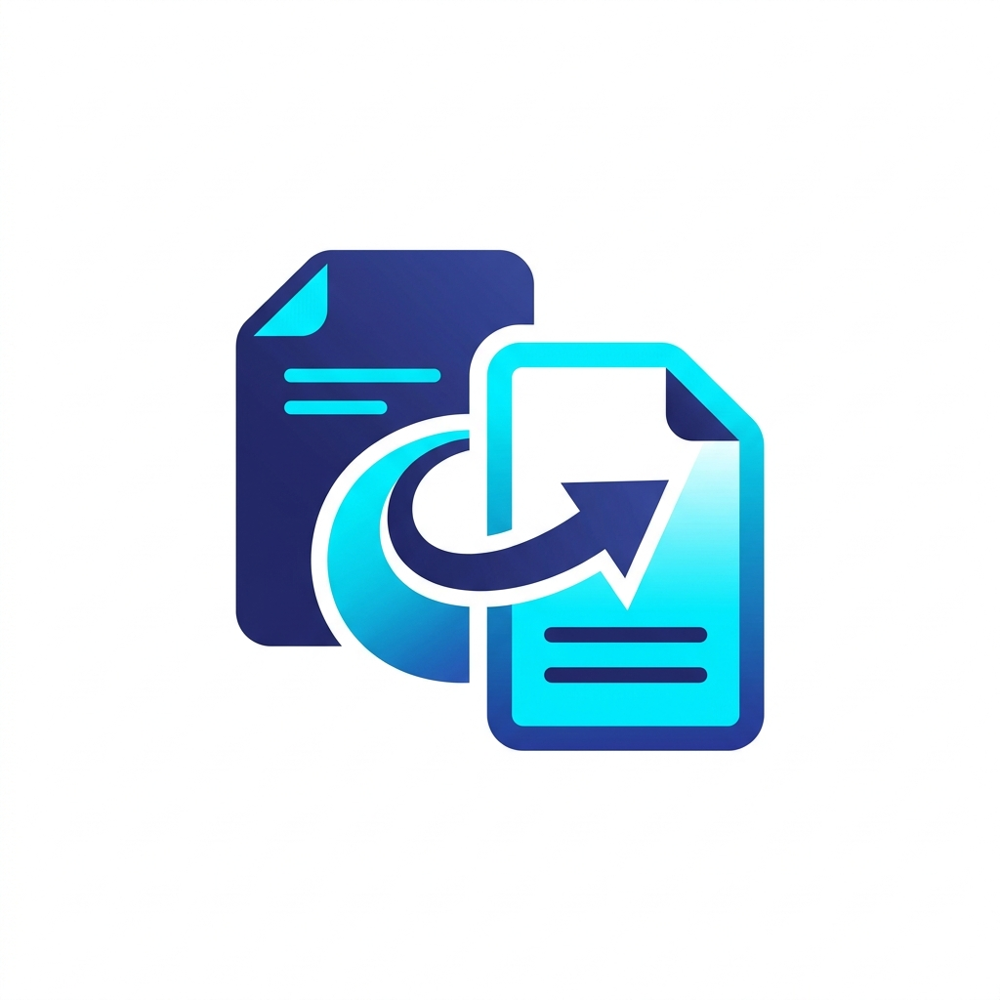

<p align="center">
  
</p>

<h1 align="center">ForChange</h1>

<p align="center">
  <strong>High-performance, multi-edition media converter for Windows — images, video, and audio — with native Windows Explorer context menu integration.</strong>
</p>

<p align="center">
  
  
  
  
  
  
</p>

<p align="center">
  <a href="README.md">English</a> &nbsp;|&nbsp; <a href="README.tr.md">Türkçe</a>
</p>

---

## Overview

**ForChange** is a fast, modular media conversion suite engineered for Windows. It provides comprehensive media processing capabilities across images, video containers, and audio tracks, featuring both headless CLI execution and two distinct graphical interfaces:

1. **Classic Win32 Edition** — Native Windows interface with classic utility aesthetics (Walk Win32 library), designed for speed and minimal system overhead.
2. **Modern Edition** — Web-based desktop interface (Wails v2 + Vite) featuring an obsidian dark mode, smooth transitions, and real-time conversion telemetry.

Both editions are available in **Lightweight** (external FFmpeg) and **Standalone** (embedded FFmpeg with zero external dependencies) binaries, compressed with UPX LZMA for minimal distribution size.

---

## Editions and Distributions

| Binary Name | GUI Engine | FFmpeg Dependency | UPX Size | Description |
| :--- | :--- | :--- | :--- | :--- |
| **ForChange_Classic.exe** | Walk (Win32) | External / System PATH | **~2.0 MB** | Lightweight native utility with near-zero memory footprint. |
| **ForChange_Modern.exe** | Wails v2 (WebView2) | External / System PATH | **~3.5 MB** | Modern interface with dark/light themes and drag-and-drop. |
| **ForChange_Classic_Standalone.exe** | Walk (Win32) | **Embedded (Self-contained)** | **~27.3 MB** | 100% portable single-file binary; runs on any Windows PC. |
| **ForChange_Modern_Standalone.exe** | Wails v2 (WebView2) | **Embedded (Self-contained)** | **~28.6 MB** | Modern glassmorphism UI with fully integrated media engine. |

> **Standalone Architecture Note:** The standalone variants embed a complete FFmpeg toolset directly into the executable using Go build tags (`embed_ffmpeg`). On initial execution, the binary validates and extracts the engine to `%LOCALAPPDATA%\ForChange` with atomic byte-level integrity verification.

---

## Supported Formats

### Image Formats

| Format | Decode | Encode | Notes |
| :--- | :---: | :---: | :--- |
| **PNG** | Yes | Yes | High-compression lossless encoding |
| **JPEG / JPG** | Yes | Yes | Adjustable quality factor (1–100) with transparency composite |
| **GIF** | Yes | Yes | Standard 256-color palette quantization |
| **BMP** | Yes | Yes | Uncompressed native bitmap |
| **TIFF / TIF** | Yes | Yes | Deflate compression enabled |
| **WEBP** | Yes | No | Pure Go decoding pipeline |
| **ICO** | Yes | Yes | Square canvas padding with Catmull-Rom resampling (16–256 px) |

### Video Formats

| Format | Decode | Encode | Notes |
| :--- | :---: | :---: | :--- |
| **MP4** | Yes | Yes | H.264 video, AAC audio, `+faststart` web optimization |
| **MKV** | Yes | Yes | Matroska container with multi-track support |
| **WEBM** | Yes | Yes | VP9 video codec, Opus audio codec |
| **AVI** | Yes | Yes | MPEG-4 video codec, MP3 audio codec |
| **MOV** | Yes | Yes | Apple QuickTime compatible container |
| **GIF (from Video)** | Yes | Yes | Two-pass Lanczos palettegen / paletteuse animated GIF |

### Audio Formats

| Format | Decode | Encode | Notes |
| :--- | :---: | :---: | :--- |
| **MP3** | Yes | Yes | High-quality LAME encoder (up to 320 kbps) |
| **WAV** | Yes | Yes | Uncompressed 16-bit PCM |
| **FLAC** | Yes | Yes | Lossless audio compression |
| **AAC** | Yes | Yes | Native AAC encoder |
| **M4A** | Yes | Yes | AAC inside MPEG-4 audio container |
| **OGG** | Yes | Yes | Vorbis audio codec |

---

## Windows Explorer Context Menu Integration

ForChange integrates directly into the Windows Explorer cascading right-click context menu, enabling one-click file conversions without opening a window.

### Architecture

Shell verbs are registered in the Windows Registry under `Software\Classes\SystemFileAssociations`. This approach:
- Preserves default system file handlers (VLC, Media Player, Windows Photo Viewer).
- Appears reliably across Windows 10 and Windows 11.
- Features dual-registration for common containers (`SystemFileAssociations\video\shell` and per-extension keys).

### Shell Menu Matrix

| Target Category | Monitored Extensions | Available Submenu Actions |
| :--- | :--- | :--- |
| **Images** | `.png`, `.jpg`, `.jpeg`, `.bmp`, `.gif`, `.tiff`, `.ico` | Convert to PNG, JPG, BMP, GIF, ICO, Open in GUI |
| **Videos** | `.mp4`, `.mkv`, `.avi`, `.mov`, `.webm` | Convert to MP4, WEBM, MKV, MP3 (Audio), GIF, Open in GUI |
| **Audio** | `.mp3`, `.wav`, `.aac`, `.flac`, `.ogg`, `.m4a` | Convert to MP3, WAV, M4A, FLAC, Open in GUI |

---

## Command-Line Interface (CLI)

All binaries support headless command-line execution for batch pipelines and scripting:

```bash
# Convert image to PNG
ForChange_Classic.exe -i input.jpg -f png

# Convert image to JPEG with custom quality factor
ForChange_Classic.exe -i photo.png -o output.jpg -f jpg -q 92

# Convert image to 256x256 Windows Icon
ForChange_Classic.exe -i app_logo.png -o app.ico -f ico -q 256

# Transcode video to MP4 container
ForChange_Modern.exe -i recording.mkv -f mp4

# Extract audio stream from video file as MP3
ForChange_Classic.exe -i presentation.mp4 -o presentation.mp3 -f mp3 -q 85

# Convert lossless audio to FLAC
ForChange_Classic.exe -i track.wav -f flac
```

### CLI Arguments

| Flag | Parameter | Description | Required | Default |
| :--- | :--- | :--- | :---: | :--- |
| `-i` | `<path>` | Path to the source media file | Yes | None |
| `-o` | `<path>` | Path to the destination file (auto-generated if omitted) | No | Next to source |
| `-f` | `<format>` | Target format name (png, jpg, mp4, webm, mp3, etc.) | Yes | None |
| `-q` | `<value>` | Encoding quality factor (1–100) or Icon size (16–256) | No | `80` (or `256` for ICO) |

---

## Build from Source

### Prerequisites

- Go (Golang) 1.23 or higher
- Node.js 18+ and `npm` *(Modern Edition only)*
- Wails CLI v2 *(Modern Edition only)*
- Inno Setup 6 *(Optional, for generating setup installers)*
- UPX 5.x *(Optional, for executable compression)*

### Compilation Steps

1. **Clone the repository:**
   ```bash
   git clone https://github.com/tommyvercetti89/ForChange.git
   cd ForChange
   ```

2. **Build Classic Edition (Lightweight):**
   ```bash
   go build -ldflags="-s -w -H windowsgui" -o ForChange_Classic.exe .
   ```

3. **Build Classic Edition (Standalone with Embedded FFmpeg):**
   ```bash
   go build -tags embed_ffmpeg -ldflags="-s -w -H windowsgui" -o ForChange_Classic_Standalone.exe .
   ```

4. **Build Modern Edition (Lightweight):**
   ```bash
   cd modern/frontend && npm install && npm run build && cd ..
   go build -tags "desktop,production" -ldflags="-w -s -H windowsgui" -o ..\ForChange_Modern.exe .
   cd ..
   ```

5. **Build Modern Edition (Standalone with Embedded FFmpeg):**
   ```bash
   cd modern
   go build -tags "desktop,production,embed_ffmpeg" -ldflags="-w -s -H windowsgui" -o ..\ForChange_Modern_Standalone.exe .
   cd ..
   ```

6. **Compress with UPX (Optional):**
   ```bash
   upx --best --lzma ForChange_Classic.exe ForChange_Modern.exe ForChange_Classic_Standalone.exe ForChange_Modern_Standalone.exe
   ```

7. **Compile Installers:**
   ```bash
   & "C:\Program Files (x86)\Inno Setup 6\ISCC.exe" setup.iss
   & "C:\Program Files (x86)\Inno Setup 6\ISCC.exe" setup_modern.iss
   ```

---

## Repository Structure

```
ForChange/
├── main.go                          # Root entry point — CLI routing & GUI initialization
├── main.manifest                    # Windows Common Controls manifest
├── cli/
│   └── cli.go                       # Headless CLI execution engine
├── converter/
│   ├── converter.go                 # Pure-Go image processing & format router
│   ├── media.go                     # Video and audio transcoding engine
│   ├── ffmpeg.go                    # FFmpeg discovery, extraction & integrity validation
│   ├── ffmpeg_embedded.go           # Embedded FFmpeg binary directive (-tags embed_ffmpeg)
│   └── ffmpeg_noembed.go            # Stub directive for external FFmpeg builds
├── gui/
│   └── gui.go                       # Native Win32 classic interface (Walk)
├── modern/
│   ├── main.go                      # Wails v2 desktop entry point
│   ├── app.go                       # Go-to-JS bridge methods & filesystem dialogs
│   ├── wails.json                   # Wails project configuration
│   └── frontend/                    # Web GUI (HTML5, Vanilla CSS, ES modules, Vite)
├── assets/                          # Application icons and branding assets
├── setup.iss                        # Inno Setup configuration — Classic Edition
└── setup_modern.iss                 # Inno Setup configuration — Modern Edition
```

---

## Security and Privacy

- **Zero Telemetry:** ForChange contains no analytics, telemetry, or remote communication code.
- **Local Execution:** 100% of media decoding, transformation, and encoding occurs locally on your machine.
- **Non-Destructive Registry:** Context menu integration registers under standard file associations and uninstalls cleanly without leaving orphaned registry artifacts.

---

## Credits and Collaboration

Developed by **tommyvercetti89** in collaboration with **Antigravity**, an agentic AI coding assistant designed by Google DeepMind.

---

## License

This project is licensed under the terms of the [MIT License](LICENSE).
